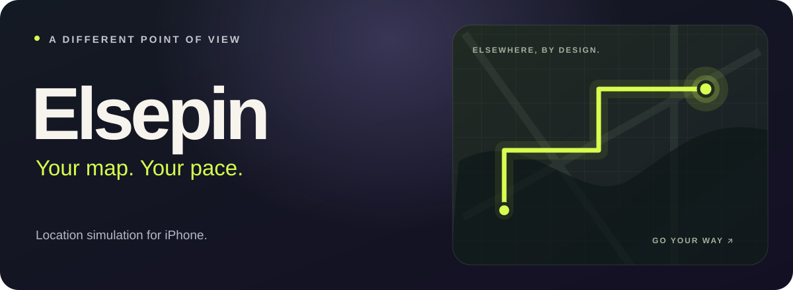

  <strong><a href="https://elsepin.onrender.com/">Visit the website ↗</a></strong> &nbsp; · &nbsp;
  <a href="https://github.com/N3moStudio/Elsepin-Releases/releases">Releases</a> &nbsp; · &nbsp;
  <a href="SETUP.md">Get started</a> &nbsp; · &nbsp;
  <a href="CHANGELOG.md">What's new</a>

**Pick a place. Make your move.** Teleport, build routes and keep your favorite
places together in a native iPhone app.

### Go somewhere different

- **Move your way.** Joystick, walking, cycling and driving. Preview routes, set stops and choose your pace.
- **Keep your places.** Favorites, saved routes and areas, with selective backup/import.
- **Stay in control.** Live Activities, Dynamic Island and widgets that wait for your confirmation.

### Make it yours

   &nbsp;&nbsp;
   &nbsp;&nbsp;
  

**9 themes · 13 icons · Your own finish.** Dark Ion, solid or glass surfaces,
custom fonts and text sizes. [Explore the themes →](https://elsepin.onrender.com/)

---

[iOS setup](SETUP.md) · [Backups](docs/BACKUPS.md) · [Cloud guide](docs/CLOUD-GUIDE.md) · [Build history](docs/BUILD-HISTORY.md) · [Report an issue](https://github.com/N3moStudio/Elsepin-Releases/issues)

iOS 18+; compatible pairing and signing required. Optional Find My Devices/Life360 checks are experimental; Find My People is unsupported. <a href="LICENSES.txt">Credits & licenses</a> · <a href="https://elsepin.onrender.com/privacy.html">Privacy</a>
