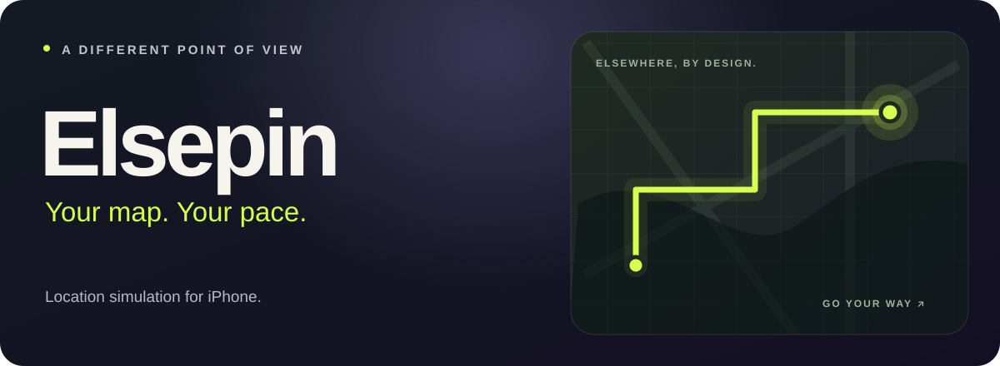

  <a href="https://github.com/N3moStudio/Elsepin-Releases/releases/latest"><strong>Download Elsepin</strong></a> &nbsp; · &nbsp;
  <a href="https://elsepin.onrender.com/">Explore the app</a> &nbsp; · &nbsp;
  <a href="SETUP.md">Setup guide</a> &nbsp; · &nbsp;
  <a href="CHANGELOG.md">Update log</a>

**Choose a place, plan the journey, set the pace.** Elsepin brings location simulation, route planning and a personal places library together in a native iPhone app.

> **Available now:** [2.6.0](https://github.com/N3moStudio/Elsepin-Releases/releases/tag/v2.6.0). **In final testing:** 2.6.1, through build 86. The next update has not been released.

## More than a destination

| On the map | In your hands |
| --- | --- |
| **Teleport or explore** | Search for a place, drop a pin, or move freely with the joystick. Preview first; start when you're ready. |
| **Make a journey** | Walk, run, cycle, use e-bike mode or drive. Draw a path or plan directions, set the pace in mph/km/h, and add timed stops. |
| **Keep your places** | Save pins and routes, organize folders, and draw named areas. Bring your library with you through selective backup import and export. |
| **Stay in control** | Pause a route, hold a location, or request Stop. Follow session progress through Live Activities and Dynamic Island. Widgets prepare a destination for confirmation in the app. |

## A closer look at 2.6.1

The next update makes the details easier to control:

- Give **each route leg its own movement mode and speed**. Keep the existing path or recalculate when switching modes.
- Prepare a **next route** from the destination, with an optional one-time automatic start. Cancel it without stopping the current journey.
- **Save without favoriting**, or do both. Unfavoriting keeps the saved item. Reopen planned routes from Recents.
- Use **larger editor maps, full-screen search and Undo/Redo corners**. Customize pin symbols, emoji, colors, size and zoom visibility.
- Read **compact, adaptable controls** with reachable Pause/Stop, a map scale, clearer search recovery and pairing cancellation fixes.
- Try the **isolated demo library** before changing your own data. Review backup additions and changed settings before importing.

[All changes since 2.6.0](docs/CHANGES-SINCE-2.6.0.md) · [Every recorded build](docs/BUILD-HISTORY.md)

## Make it yours

   &nbsp;&nbsp;
   &nbsp;&nbsp;
  

2.6.1 has **eight themes and thirteen app icons**, with Solid or Liquid Glass surfaces. Bloom is the new default. Larger accessibility text and reduced-transparency settings remain supported. [Try the interactive appearance preview](https://elsepin.onrender.com/).

## Before your first move

You'll need a compatible iPhone running iOS 18 or later, an IPA signing method, **Wi-Fi, LocalDevVPN and a valid pairing connection**. On-device pairing depends on iOS support; importing a compatible pairing file is also available. [Follow setup](SETUP.md).

If Elsepin can't clear the location, connect to Wi-Fi, reconnect LocalDevVPN, and try again. **Another device's Wi-Fi hotspot can also work.** Closing or force-quitting Elsepin doesn't confirm that it cleared. Check another map app too.

Compatibility and location limits

Session status describes the connection and updates Elsepin sent. It does not prove that every other app has refreshed its location. Compatibility, widget availability and Live Activities depend on iOS and signing capabilities. Elsepin does not hide your IP address or guarantee undetectability.

Existing Find My Devices/Life360 helper checks are experimental and may return stale reports or stop working. Find My People is unsupported. A proposed fresh Life360 map integration is **not included** in this update.

[Report an issue](https://github.com/N3moStudio/Elsepin-Releases/issues) · [Backups](docs/BACKUPS.md) · [Privacy](https://elsepin.onrender.com/privacy.html) · [Credits & licenses](LICENSES.txt)

Made by N3mo Studio. This repository contains public downloads and documentation. Elsepin's development repository is private. Elsepin continues Shift and includes work from Locus and idevice; their notices and licenses remain included.